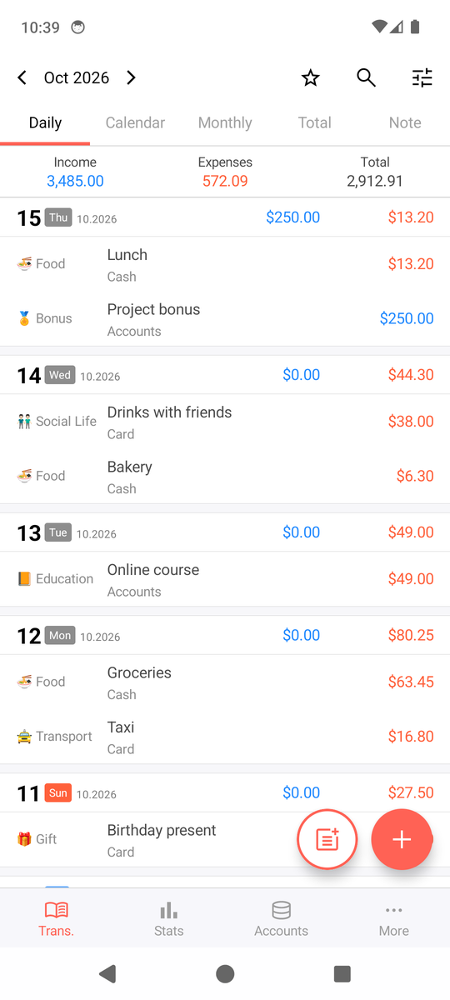
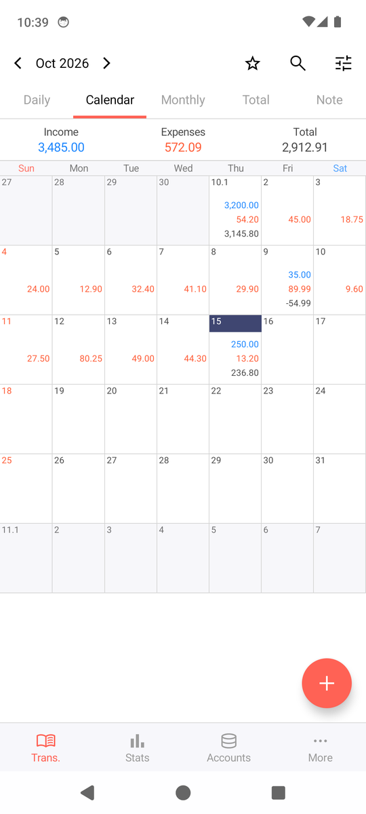
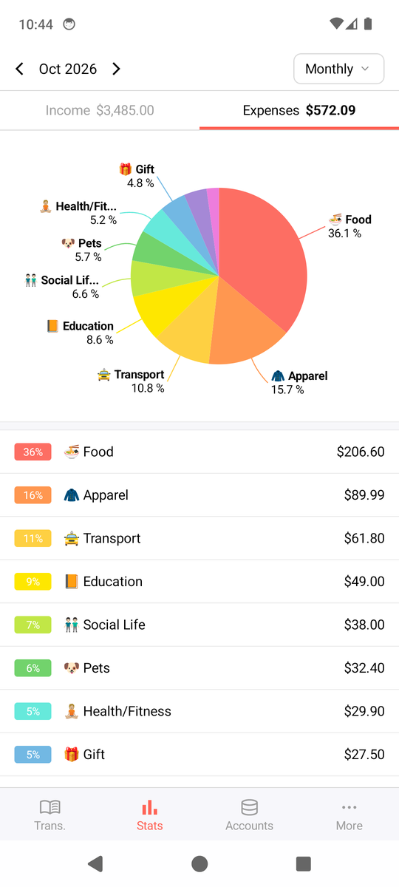
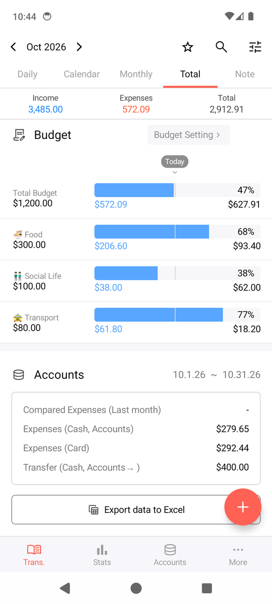
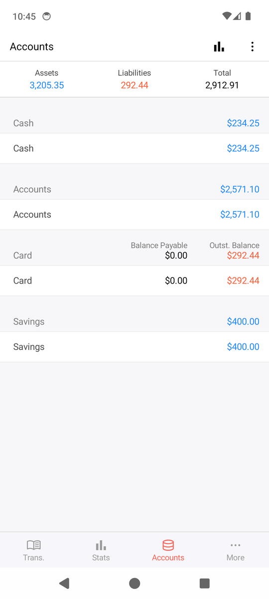
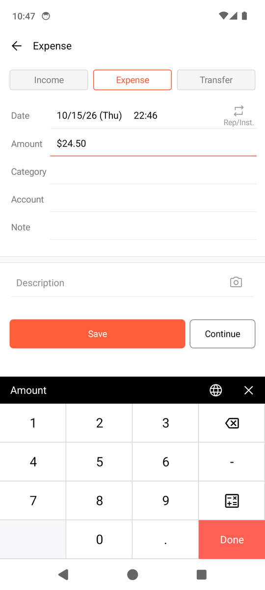
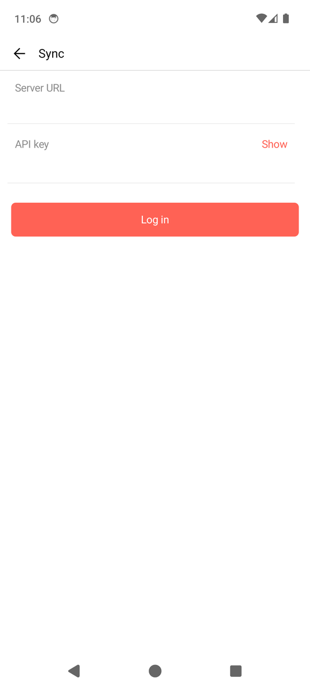

# MoneyBook

An offline-first personal finance app for Android, with an optional self-hosted sync and backup server.

- Entries (income, expense, transfer), accounts and cards, categories with subcategories
- Budgets, stats (pie, trend), calendar and monthly views, carry-over
- Repeats and installment plans, bookmarks, search, calculator keypad
- Multi-currency with exchange rates, photos on entries
- Passcode and biometric lock, home-screen widgets, daily reminder, quick add
- Excel import and export in the Money Manager (Realbyte) format, on-device backups
- Optional sync between your devices through your own server (Docker + Postgres), private over Tailscale

All data stays on your phone unless you set up the server. The screenshots below use made-up demo data.

<table>
  <tr>
    <td></td>
    <td></td>
    <td></td>
    <td></td>
  </tr>
  <tr>
    <td></td>
    <td></td>
    <td></td>
    <td></td>
  </tr>
</table>

## Install the app

1. Open the **Releases** page of this repository and download `moneybook-<version>.apk` (or, for a build of the latest commit, open the **Actions** tab, pick a run and download the APK artifact).
2. Copy it to your phone and open it. Android asks to allow installs from this source (Settings, Install unknown apps); allow it once.
3. Requires Android 8.0 (API 26) or newer.

Updates install over the old version as long as they are signed with the same key. An unsigned APK (from a fork without the signing secrets) can only be installed once, after removing any signed copy.

## Run your own sync server (optional)

You need a machine that is always on (a home server, a NAS, a small VPS) with Docker and Compose v2, and [Tailscale](https://tailscale.com) on it and on your phone.

```bash
git clone <this repository> && cd <repository>/deploy
cp .env.example .env              # set POSTGRES_PASSWORD, MB_JWT_SECRET (openssl rand -base64 48), MB_API_KEY (openssl rand -hex 32), TZ
mkdir -m 700 backups
docker compose up -d --build      # use sudo if your user is not in the docker group
tailscale serve --bg --https=443 http://127.0.0.1:8095      # HTTPS inside your tailnet
```

Then in the app open **More, Sync**, enter `https://<machine>.<tailnet>.ts.net` as Server URL and your `MB_API_KEY` as API key, and log in. When the server and the phone both hold data you choose to merge them or replace one side. Sync is opt-in, works offline-first and pushes changes in the background.

The server also makes nightly backups (database and photos) and has a tested restore script. See [deploy/README.md](deploy/README.md) for details (ports, backups, restore, updating).

## Build from source

Requirements: JDK 17 and the Android SDK (platform 37). There are three independent Gradle builds, each with its own wrapper:

```bash
cd shared  && ./gradlew test                     # pure Kotlin library: formats, importers, wire types
cd server  && ./gradlew test                     # needs Docker (Testcontainers starts Postgres)
cd android && ./gradlew :app:testDebugUnitTest   # JVM and Robolectric tests, no device needed
cd android && ./gradlew :app:assembleDebug       # app/build/outputs/apk/debug/
```

A signed release build needs your own keystore: set `MB_KEYSTORE_FILE`, `MB_KEYSTORE_PASSWORD`, `MB_KEY_ALIAS` and `MB_KEY_PASSWORD` and run `./gradlew :app:assembleRelease`. Without them the release APK is unsigned. The GitHub Actions workflow (`.github/workflows/android.yml`) does the same from the repository secrets `MB_KEYSTORE_BASE64`, `MB_KEYSTORE_PASSWORD`, `MB_KEY_ALIAS` and `MB_KEY_PASSWORD`, and publishes a release for every `v*` tag.

## Project layout

- `shared/` Kotlin/JVM library used by the app and the server: money and currency formats, Excel and backup codecs, the sync wire types
- `android/` the app (Kotlin, Jetpack Compose, Room)
- `server/` the sync and backup server (Kotlin, Ktor, Postgres)
- `deploy/` Docker Compose stack, backup and restore scripts
- `tools/` small developer helpers (icons, adb scripts)

`CLAUDE.md` describes the architecture in detail.

## Disclaimer

MoneyBook is an independent project. It is not affiliated with or endorsed by Realbyte or the Money Manager Expense & Budget app; it only reads and writes the same Excel layout so you can bring your data along.

## License

All rights reserved. (No license has been chosen yet.)
